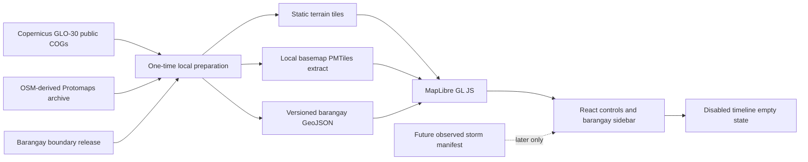

# Flood Rewind: Los Baños 3D map viewer plan

**Status:** planning proposal, not an implementation.  
**Reference:** `Flood-Rewind-What-the-Typhoon-Left-Behind.pdf`.  
**Decision:** build the geographic stage now; connect a real storm replay later. No water or flood rendering in this phase.

## 1. Outcome and boundaries

Create a desktop-first, interactive web map of **Los Baños, Laguna**: a light, model-like oblique view of real topography, extruded building footprints, and clear selectable barangay boundaries. Selecting a barangay opens a sidebar with its real available name and identifier. A visible but disabled timeline explains that no storm observations are loaded. Mobile gets usable navigation and a bottom-sheet version of the sidebar, not a separate product.

This is an **isometric-inspired perspective map**, not a geometrically orthographic isometric projection. MapLibre's tilted perspective gives useful navigation and terrain without the cost of a custom 3D engine. The third reference informs the light building-massing aesthetic, not floodwater or the promise of a photorealistic city model.

### In scope

- One municipality, recognizable surrounding geographic context, free data and tools, with **no payment card required**.
- Copernicus GLO-30-derived terrain; real available building footprints with approximate extrusion; sourced barangay polygons, names and PSGC identifiers.
- Pan, zoom, rotate, pitch, reset view, select/clear barangay, toggle boundaries/buildings, accessible controls and attribution.
- Disabled storm selector/timeline shell and an honest empty sidebar state; no fabricated dates or statistics.
- Static deployment architecture and a data-preparation recipe suitable for a hackathon.

### Not in scope

- Storm selection, Sentinel-1 processing or imagery display, real or synthetic observations, water geometry, flood color overlays, flood depth/extent/duration, rainfall charts, photo uploads, accounts, backend, multi-municipality UI, or alerting.
- Operational flood prediction, emergency response, property-level analysis, surveying, or exact building models.

The later replay is the project's goal, not a deliverable of this stage. A disabled shell must not suggest that an event was observed or that an empty value means zero flooding.

## 2. Scientific and visual constraints that change the design

1. **A day-by-day satellite replay is not guaranteed.** Sentinel-1 observations are irregular and may miss the peak. Later, timeline stops must be actual acquisition timestamps; a daily calendar, if ever used, must show missing days and identify modeled frames separately. Do not animate invented intermediate observations as fact.
2. **Flood extent is not flood depth.** SAR water classification plus GLO-30 elevation cannot, by themselves, establish water depth or a physically accurate 3D flood surface. Defer any depth claims until a defensible independent method and data exist.
3. **GLO-30 is a surface model, not bare earth.** Its ~30 m cells can include vegetation and buildings. Adding footprint extrusions can visually double-count their height; neither the terrain nor the resulting building base is survey-grade. Do not read off elevations or use the mesh to calculate flood depth. Use modest or no vertical exaggeration and disclose any exaggeration.
4. **Buildings are schematic.** OpenStreetMap coverage and height attributes vary. A default height is a visual approximation, not an observation; gaps are unknown rather than empty land. Buildings may not match historical storm dates.
5. **Boundaries are reference geometry, not legal adjudication.** Pin a version, state source and date, and verify coverage and geometry. Simplification can distort small barangays. Local selections communicate a place, not verified flood exposure.
6. **Brief's duration shortcut needs qualification.** The span between first and last flooded observations is not automatically a guaranteed continuous flooded duration: recession and reflooding may occur between passes. A later duration range requires explicit continuity assumptions, missing-data treatment and independently reviewed methodology; missing dry bounds can make an upper bound unknown. Do not implement that shortcut in the viewer.

## 3. Experience and behavior

### Default view

- Open on the municipal extent, with shoreline and neighboring context visible. Use a fit-to-bounds camera from the pinned barangay geometries, a moderate oblique pitch (start around 50–60°) and a bearing chosen during visual review. Expose a reset button; do not force a fixed camera.
- Use pale neutral terrain and buildings, restrained roads/place labels, and a contrasting boundary line. Highlight the selected barangay with a distinct outline and translucent fill that does not obscure buildings. Maintain enough contrast for the line and controls; do not rely on color alone.
- Keep terrain, individual buildings and boundaries legible at their useful zoom levels. Whole-municipality framing may hide small buildings; zooming should reveal them rather than implying that each building is visible from the outset.
- This is an interactive map, not a decorative miniature: retain navigation, orientation, source attribution and a way to locate the selected barangay.

### Selection and sidebar

- An invisible or near-transparent **polygon fill hit target** makes the whole barangay selectable, not just a thin boundary line. Clicking a building inside a polygon must not prevent polygon selection; query the barangay fill layer explicitly. Resolve shared-edge hits deterministically and give a click target large enough to use.
- Selection highlights one feature and opens a non-modal side panel on desktop; it does not trap map navigation. Show barangay name, **10-digit PSGC string**, municipality and source/version; show only fields actually present and trustworthy. The data source writes PSGCs as numbers, so normalize to strings with leading zeroes restored; do not use a numeric PSGC as the app's canonical key.
- Timeline section: **“No storm data available”** and **“Flood observations are not included in this version.”** No date, zero-value chart, fake severity, or implied slice. Close clears selection; choosing another barangay replaces it. A list/searchable selector provides a keyboard-accessible alternative to map hit-testing and keeps the selected item synchronized.
- On narrow screens, use a dismissible bottom sheet with map interaction still possible and controls unobscured. Respect reduced motion for camera transitions.

### Timeline shell

Display a disabled event control, inactive track and disabled play/previous/next controls labeled **“Storm replay coming later”**. Do not show placeholder dates, an active thumb or sample data. Native disabled semantics and an explanatory label must work with keyboard and screen readers. Selection remains available independently of the timeline; there is currently no selected time slice.

### Loading and failure

Show a useful map-loading state, and identify failures independently: boundaries, buildings/basemap, terrain, or WebGL. A terrain failure may fall back to a flat map only with a visible “Terrain unavailable” notice; it must not masquerade as GLO-30. If boundaries fail, disable selection and explain why. Do not synthesize geometry. Display persistent source credits and a plain-language **“Not an official hazard map”** notice.

## 4. Recommended architecture

- **Application:** existing React 19 + Vite project; add MapLibre GL JS, its stylesheet, and the PMTiles protocol library. Use MapLibre directly inside one React-owned map component; avoid introducing another mapping framework or 3D engine.
- **Renderer:** a style with a neutral land/background, restrained OSM context, `raster-dem` GLO-30 tiles and terrain, a zoom-gated `fill-extrusion` building layer, barangay polygon hit/highlight layers, boundary lines, and minimal labels. Confirm layer ordering and terrain draping on the chosen MapLibre version in a real browser, rather than assuming every layer will align correctly on slopes.
- **State:** React owns `selectedBarangayId`, sidebar open/closed, visibility preferences and source readiness/errors. MapLibre owns camera and map rendering. Update feature-state for highlighting and keep source listeners/layers registered once; clean up map, listeners and PMTiles protocol appropriately on unmount. No timeline state beyond an explicit unavailable state in this phase.
- **Delivery:** static host serves the app and prepared municipality assets over HTTPS. PMTiles requires byte-range support and correct CORS if served from another origin; verify with an actual request. For a small extract, same-origin hosting avoids API keys and third-party runtime dependence. The app needs no custom API or database. Confirm the chosen free host's quota and deployment terms before the demo; local Vite preview is the fallback, not a promised offline deployment.
- **AOI:** derive bounds from the validated polygons, add a modest buffer for camera and tile extraction, and retain enough surroundings to avoid a sharp cutout. Restrict the demo's focus to Los Baños without presenting neighboring land as part of the municipality.

### Data sources and gates

| Layer | Candidate and preparation | Verification / limitation |
|---|---|---|
| Elevation | [Copernicus GLO-30 Public COGs](https://registry.opendata.aws/copernicus-dem/): public S3 access without an AWS account. Acquire the tiles intersecting the AOI and buffer, mosaic/reproject and encode as MapLibre-compatible Terrarium `raster-dem` tiles; serve the small resulting tile set statically. | GLO-30 public coverage has exceptions. **AOI tile availability and license/attribution are a pre-build gate**, not yet verified. Verify encoding, NoData, seams, zoom range, CORS, and that units/datum remain documented. Do not silently replace it with another DEM. |
| Buildings and map context | Extract a buffered AOI from a pinned [Protomaps basemap build](https://docs.protomaps.com/basemaps/downloads) into PMTiles. Use its OSM-derived `buildings` source layer and minimal roads/land context. | The [schema](https://docs.protomaps.com/basemaps/layers) says individual buildings occur at z15+ and `height`/`min_height` may exist. Inspect actual local coverage and attribute values first; the downloadable planet includes zooms 0–15, so do not promise finer source detail. Heights may be missing. Protomaps discourages hotlinking build files. |
| Barangays | Candidate: [municipality GeoJSON](https://raw.githubusercontent.com/faeldon/philippines-json-maps/master/latest/geojson/municities/medres/bgysubmuns-municity-403411000.0.01.json), then pin a dated release and copy the selected licensed asset locally. | The observed file contains 14 polygon features, including Bagong Silang and Batong Malake. Its source is simplified: tiny Tadlak becomes a triangle and rounded area fields can be zero. Compare with a higher-resolution release and the [PSA list](https://psa.gov.ph/classification/psgc/barangays/0403411000) before use; PSA page access was blocked during planning. Source may omit areas without shapes. |
| Official names/codes | PSA PSGC list; normalize provider IDs to ten-character strings. Municipality code: `0403411000`. | Verify list and vintage against geometry. A PSGC identifies an administrative unit; it does not certify geometry. Do not report the dataset's integer-rounded area as precise statistics. |

**Free does not mean unlimited or forever available.** All candidate inputs avoid a payment-card prerequisite, but acquisition, hosting quotas, service availability, and per-source licensing must be confirmed at build time. The product must display OSM attribution, credit NAMRIA and PSA via OCHA COD-AB for the barangay geometry, preserve applicable dataset notices, and cite Copernicus DEM according to its license. Record exact source URLs, release/date, retrieval date, transformations and licenses next to prepared assets. The boundary repository's MIT license does not replace its underlying CC BY-IGO attribution obligations.

### Data-preparation outline

1. Validate the Los Baños polygon source against the authoritative name/code list; inspect high-resolution geometry at the shoreline and small barangays, polygon validity, duplicates, omissions and shared-edge consistency. Pin the chosen release; store identifiers as strings. Keep the AOI envelope derived from this exact dataset.
2. Confirm public GLO-30 COG coverage for the buffered AOI. With GDAL or an equivalent reproducible tool, mosaic source tiles, handle NoData explicitly, warp to the web map's tile grid, encode elevation into Terrarium RGB, and generate only required zooms. Record source resolution, vertical datum, conversion and tile bounds; test decoded known samples against source values. Never treat RGB as ordinary imagery.
3. Use the [PMTiles extract workflow](https://docs.protomaps.com/basemaps/downloads) on a pinned Protomaps build to obtain only the buffered region and required zooms. Inspect local `buildings` features and height units/availability. Persist the extract and style-compatible schema version.
4. Use actual numeric building `height` and `min_height` only when valid; otherwise use a consistent, documented schematic height (e.g. 6 m), not random or invented per-building values. Filter address points and avoid duplicating building parts and parent footprints where the source permits; check a representative dense area visually. Do not imply default heights are measured.
5. Serve static assets with correct MIME types, byte ranges and caching. Verify asset load, attribution and the visible map on the actual demo host. A chosen free hosting provider is an implementation decision, not an unverified promise.

**Hard dependency:** if GLO-30 availability, usable building coverage, boundary completeness, local asset preparation, or the intended host cannot be verified, report the specific limitation before describing the demo as meeting that layer. A flat/partial map is an explicit degraded state, not a substitute passed off as complete.

## 5. Future replay integration boundary — not implemented now

Keep future temporal data separate from the static geography; no dummy flood records or speculative processing pipeline now. When a real event exists, a versioned manifest can describe an event, ordered observation timestamps in UTC, source/provenance, quality and URLs for precomputed layers and summaries. The UI can display Philippine local time with timezone, but retain original timestamps. A barangay summary would join on a **versioned PSGC string**, with an explicit crosswalk if the storm-era and boundary vintages differ.

Future consumers must distinguish at least `observed`, `modeled` and `unknown` states; missing coverage, invalid scenes and unavailable barangay metrics must never be zero-filled. A selected barangay and selected observation are independent state dimensions. Later design must settle multiple passes on one date, missing dates, SAR coverage footprints, uncertainty, real flood extent versus depth, duration methodology, and validation before showing any storm-related value. Do not add a backend just to anticipate these needs.

## 6. Implementation sequence

1. **Data spike and visual feasibility:** verify GLO-30 tile coverage, inspect local OSM buildings and height attributes, reconcile barangay list/geometry and licenses; create a small terrain + building proof on a pitched MapLibre map. Test terrain/extrusion alignment and interaction on the intended browser. This is the go/no-go gate for the visual promise.
2. **Prepare reproducible static inputs:** generate bounded elevation tiles, PMTiles extract and normalized/pinned GeoJSON with provenance. Validate sample elevations, geometry and coverage; test deployment range requests.
3. **Build map stage:** integrate sources and ordered layers into React/Vite, initialize and clean up MapLibre, frame municipality, add controls, boundaries, buildings, attribution and explicit source-error states.
4. **Build interactions:** select via polygon hit layer or accessible barangay list; synchronize highlight and sidebar; add layer toggles, desktop/mobile behavior and disabled timeline.
5. **Verify and freeze:** run the existing build and exercise the actual deployed or local browser surface. Check map, interaction, states, device layouts, source credits and constraints below. Capture a stable demo route and source versions. No storm feature work is part of this phase.

## 7. Acceptance checks

- Los Baños is framed correctly; compare the 14 candidate features with an authoritative list and visually inspect both large and small barangays, including Bagong Silang and Tadlak. Missing or disputed geometry is surfaced, not silently invented.
- In the target browser, terrain is visibly 3D and derived from the documented GLO-30 tiles; building extrusions appear where footprints exist, with fallback heights disclosed. Zoom to inspect dense and sparse areas. Confirm no unacceptable floating, buried buildings, broken tile seams or boundary displacement; adjust or report limitations rather than hiding them.
- Click inside a barangay, including on top of a building: exactly one name and normalized PSGC appear, with matching selection highlight. Switching, closing, selecting from the keyboard-accessible list and layer toggles behave consistently. Test shared edges and a small polygon.
- The timeline is present but genuinely disabled; no date, water, flood values or misleading animation appears. The sidebar explicitly says storm data is unavailable.
- Test desktop and a narrow touch viewport, keyboard navigation, visible focus, screen-reader names, reduced motion, and panel/map resizing. Attribution and the non-official disclaimer remain visible and readable.
- Simulate each source failure and WebGL failure: relevant message appears, selection is disabled if boundaries are unavailable, and fallback rendering is clearly labeled. Confirm actual host CORS/range requests and cold reload. Record observed coverage, download size and rendering performance on demo hardware rather than promising an unmeasured frame rate.

## 8. Open decisions for the later phase

- Which storm is genuinely relevant to Los Baños, and which usable Sentinel-1 passes cover the municipality before, during and after it? The research brief's Cagayan recommendation does not establish Los Baños coverage.
- Who is the primary audience for the eventual replay: residents, municipal DRRM staff, or hackathon judges? This affects terminology and information density.
- Which authoritative or licensed barangay boundary vintage should govern historical event joins, especially where names or codes changed?
- Is the desired future metric **observed flood extent**, modeled depth, duration, or a barangay-level summary? Each needs distinct data, uncertainty and validation; none follows automatically from a 3D map.
- How will observation gaps, partial SAR coverage, urban and vegetation blind spots, and permanent water be represented? What evidence is adequate before any modeled interpolation?
- What elevation datum, ground model and independent validation would support an eventual water surface or depth claim? Are the source dates compatible with the storm and present-day buildings?
- Which static host and free quotas will the team actually use, and what internet/GPU constraints apply at the venue?

## References

- [MapLibre 3D terrain example](https://maplibre.org/maplibre-gl-js/docs/examples/3d-terrain/); [Protomaps basemap downloads](https://docs.protomaps.com/basemaps/downloads) and [layer schema](https://docs.protomaps.com/basemaps/layers).
- [Copernicus DEM on AWS](https://registry.opendata.aws/copernicus-dem/): public access, surface-model characteristics and license link.
- [Philippine administrative boundary repository](https://github.com/faeldon/philippines-json-maps): source provenance, PSGC conventions, releases and underlying attribution.
- `Flood-Rewind-What-the-Typhoon-Left-Behind.pdf`: broader research concept and uncertainty cautions; this plan intentionally narrows its implementation scope.
